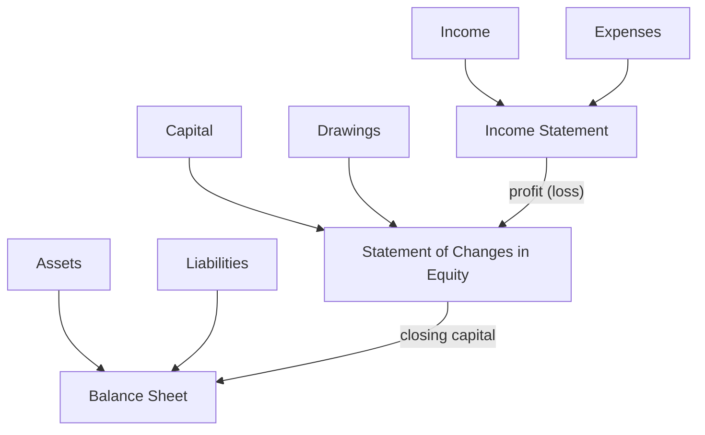

---
tags:
  - reporting
---
## Financial Statements
**Financial statements** are formal records of the financial activities and financial position of a business. The four main financial reports (statements) are:
1. [[Income Statement]] (Profit or Loss Statement)
2. [[Statement of Changes in Equity]]
3. [[Balance Sheet]] (Statement of Financial Position)
4. Statement of Cash Flows (Cash Flow Statement)

> [!todo]
> The statement of cash flows is covered in week 9.

### Preparing Financial Statements
The financial statements are prepared from the [[Trial Balance|trial balance]], after the [[Balance Day Adjustments|balance day adjustments]]. Each ledger account is classified as [[Assets|A]], [[Liabilities|L]], [[Equity|OE]], [[Income|I]] or [[Expense|E]], and each class goes into a particular statement:

| Statement | Accounts included |
| --- | --- |
| [[Income Statement]] | Income and expenses |
| [[Statement of Changes in Equity]] | Capital and drawings, plus the profit (loss) from the income statement |
| [[Balance Sheet]] | Assets and liabilities, plus the closing capital from the statement of changes in equity |

Each statement needs a figure from the one before it, so they are prepared in this order:
1. **Income statement:** gives the profit (loss).
2. **Statement of changes in equity:** gives the closing capital.
3. **Balance sheet**

### Link Between the Financial Statements
- Profit increases equity (retained earnings).
- The **income statement's** profit (loss) goes into the statement of changes in equity.
- The **statement of changes in equity** explains how profit and other factors (capital contributions, drawings) affect equity.
- The closing balance of the statement of changes in equity goes into the **balance sheet**, which shows the final equity position at the end of the period.

## Qualitative Characteristics
Qualitative characteristics are the attributes that make financial information useful to [[User|users]].

### Fundamental Qualitative Characteristics
- **Relevance:** Financial information is relevant if it can influence the economic decisions of users.
- **Faithful Representation:** Financial information must faithfully represent the economic phenomena it purports to represent.

### Enhancing Qualitative Characteristics
- **Verifiability:** Different knowledgeable and independent observers can reach a consensus that information is faithfully represented.
- **Comparability:** Users can identify and understand similarities and differences between items.
- **Timeliness:** Information is available to decision-makers in time to influence their decisions.
- **Understandability:** Information is presented clearly and concisely so that users can comprehend it.
